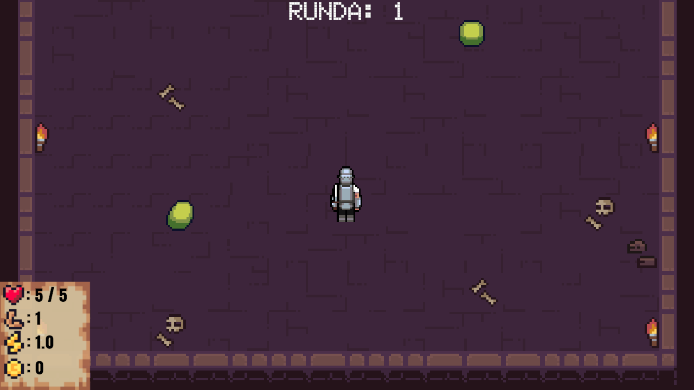
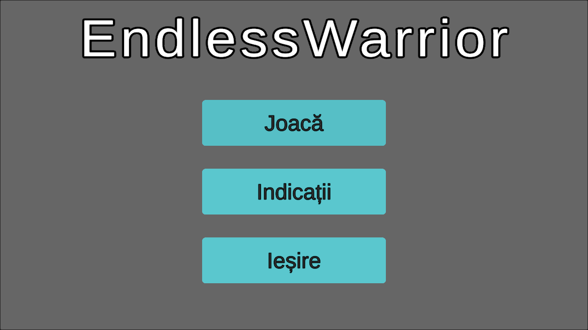
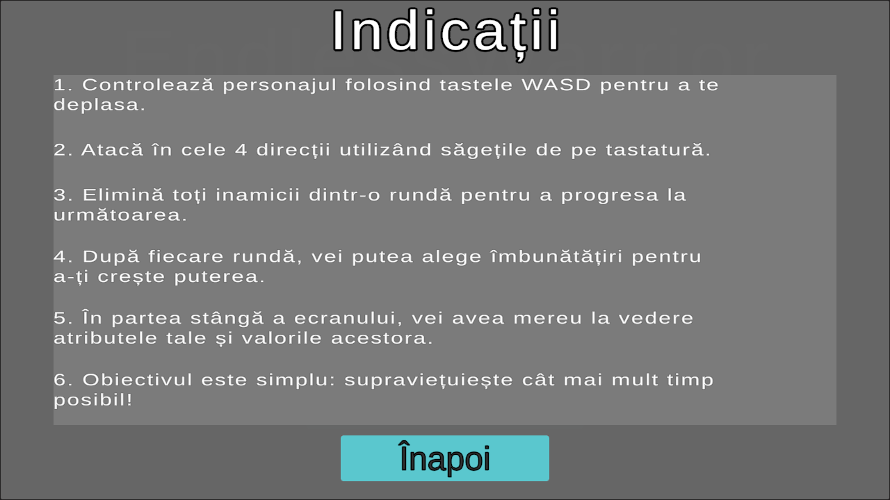

# Endless Warrior

A 2D top-down wave survival game made with Unity and C#.

I made this in 8th grade as one of my first game development projects to learn C#, 2D animation, and basic game loops.

---

## Screenshots

### Gameplay


### Main Menu & Rules




---

## Gameplay

The goal is simple: survive as many rounds as possible.

- **Movement**: `W`, `A`, `S`, `D`
- **Attack**: `↑`, `↓`, `←`, `→` (Arrow Keys for 4-directional attack)
- **Waves**: Fight through increasing waves of enemies (slimes, bees, wolves, and orcs).
- **Upgrades**: Collect coins dropped after clearing a wave and spend them to upgrade Health, Damage, or Attack Speed.

---

## Tech Used

- **Engine**: Unity (URP 2D)
- **Language**: C#
- **Patterns**: Simple state machines for player/enemy states, event-based UI updates

---

## How to Run

1. Clone the repository:
   ```bash
   git clone https://github.com/rydof/EndlessWarrior.git
   ```
2. Open **Unity Hub** and click **Add** > select the `EndlessWarrior` folder.
3. Open `Assets/Scenes/TitleMenu.unity` and hit **Play**.
